<div align="center">

# Criativo

**Fábrica de criativos de produto para o Claude Code.**<br>
A IA entrega só a matéria-prima. O movimento é escrito em código.<br>
O resultado tem cara de estúdio de motion design e custa o mesmo que um rascunho.


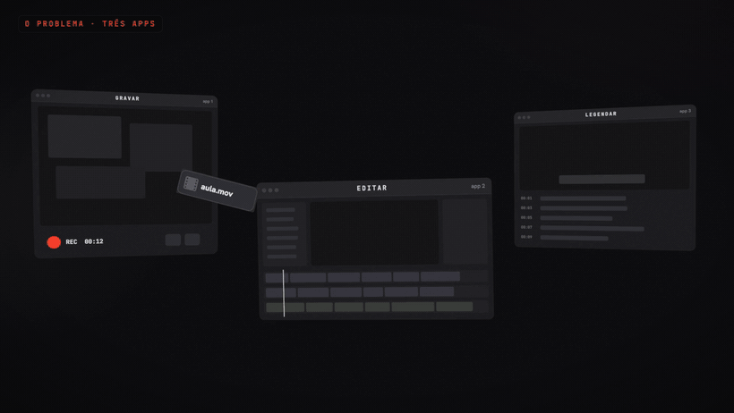

<sub>Loop de 15 s feito inteiro em código: as janelas giram, os painéis entram numa caixa e a caixa vira o ícone. Custou <b>1,8 crédito</b>, gasto só nos dois efeitos de som.</sub>

</div>

---

## Por que existe

Vídeo de IA borra texto, inventa logo e cobra caro por segundo. Motion design feito à mão leva dias. Este repositório fica no meio dos dois:

| | Vídeo de IA | **Criativo** |
|---|---|---|
| Texto e logo | derretem | texto de verdade, logo idêntico |
| Custo de um vídeo de 15 s | 15 a 120 créditos | **0 a 22 créditos** (com o modelo 3D) |
| Refazer um detalhe | gerar tudo de novo | mudar uma linha e renderizar |
| Loop perfeito | raro | o último quadro é igual ao primeiro, conferido pixel a pixel |
| Formatos 4:5, 9:16, 1:1 e 16:9 | uma geração para cada | todos saem do mesmo HTML |

A Higgsfield entra com o que a IA faz bem e barato: packshot, recorte sem fundo, camadas, modelo 3D e trilha. O resto é HTML, three.js e uma função `seek(t)`. O Playwright fotografa cada quadro e o ffmpeg monta o vídeo.

## Da foto ao vídeo

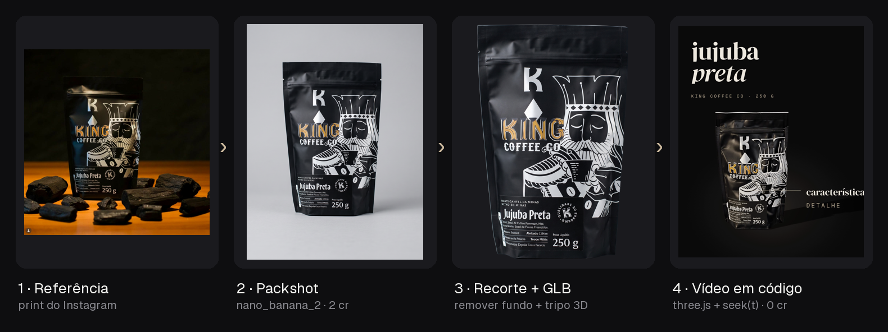

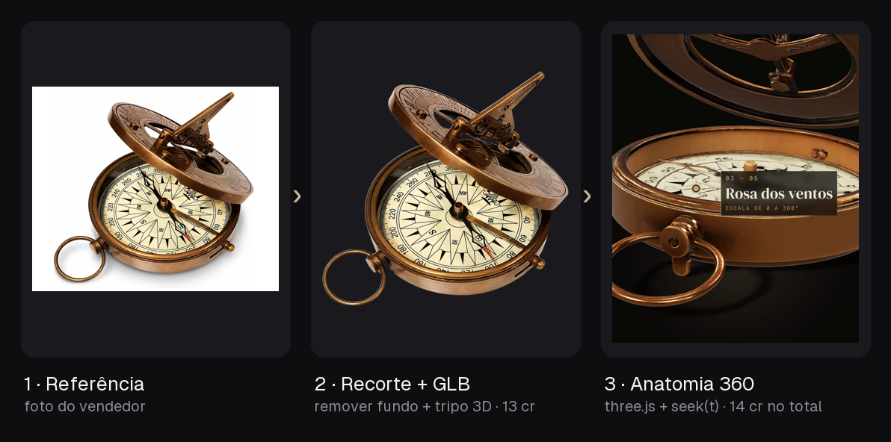

## Galeria

O valor no nome de cada arquivo é o que o vídeo custou em créditos da Higgsfield.

<table>
<tr>
<td align="center">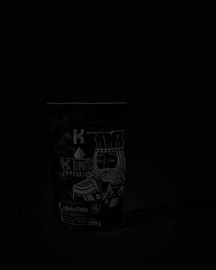<br><b>Giro 3D</b> · 22 cr<br><sub>GLB + luz que revela + destaques com fio</sub></td>
<td align="center">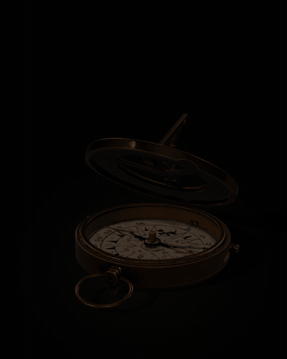<br><b>Anatomia 360</b> · 14 cr<br><sub>volta inteira + 5 mergulhos</sub></td>
<td align="center"><br><b>Anatomia</b> · 2,75 cr<br><sub>foto em 4K + hotspots + câmera</sub></td>
</tr>
</table>

### Demo de app (SaaS)

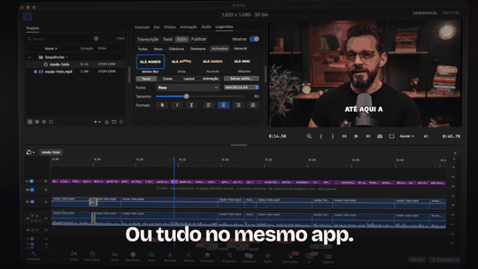

<sub>Os prints reais do app, montados em 3D, com cursor, cliques e zoom desenhados por cima. Demo de 60 s: 5 cr.</sub>

### 35 loops para página de venda, com 0 crédito

Cada loop mostra uma função do app e fecha sem emenda. Tudo foi feito com prints e gravações de tela que já existiam.

<table>
<tr>
<td>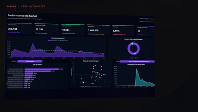<br><sub>Zoom automático e cliques</sub></td>
<td>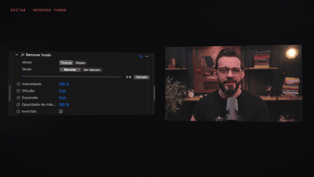<br><sub>Remover fundo</sub></td>
<td>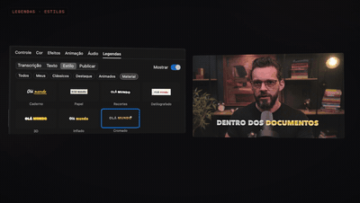<br><sub>Estilos de legenda com a fala real</sub></td>
</tr>
<tr>
<td>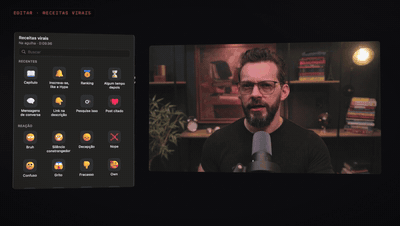<br><sub>Receita viral</sub></td>
<td>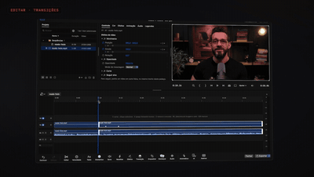<br><sub>Transições</sub></td>
<td>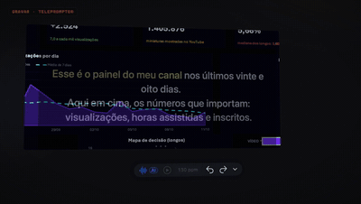<br><sub>Teleprompter</sub></td>
</tr>
</table>

## Revisão pela folha

Antes de renderizar o vídeo, o agente gera uma **folha** com um quadro por batida da música. Com ela, ele vê o vídeo inteiro de uma vez, corrige o que estiver errado e só então renderiza o vídeo.

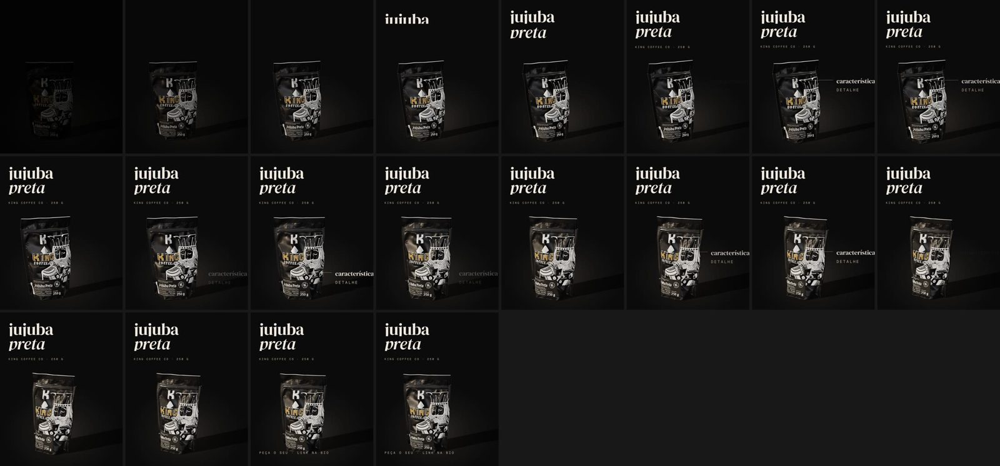

```bash
node motor/render.mjs projetos/<projeto>/video/giro.html --folha     # um quadro por batida
node motor/render.mjs projetos/<projeto>/video/giro.html --gpu       # vídeo final
```

---

## Para o agente: instalação

> **Se você é um agente (Claude Code ou outro) e acabou de abrir este repositório**, confira os itens abaixo na ordem antes de atender qualquer pedido. O fluxo completo está no [`CLAUDE.md`](CLAUDE.md).

### 1. Skills obrigatórias

Este projeto depende das skills oficiais da Higgsfield. Rode `ls ~/.claude/skills ~/.agents/skills 2>/dev/null` e confira se `higgsfield-generate` aparece na lista. Se não aparecer, instale:

```bash
npx skills add higgsfield-ai/skills
```

Alternativas: `gh skill install higgsfield-ai/skills` (GitHub CLI 2.90+) ou, dentro do Claude Code:

```
/plugin marketplace add higgsfield-ai/skills
/plugin install higgsfield@higgsfield
```

Depois de instalar, **peça para a pessoa reiniciar o agente**, porque as skills só carregam quando a sessão começa. O guia oficial é o [INSTALL_FOR_AGENTS.md](https://github.com/higgsfield-ai/skills/blob/main/INSTALL_FOR_AGENTS.md).

| Skill | Para que o fluxo usa |
|---|---|
| `higgsfield-generate` | **obrigatória.** Imagens (`gpt_image_2_5`, `nano_banana_2`), recorte, upscale, modelo 3D (`tripo_h3_1_image_to_3d`), trilha (`sonilo_music`), efeitos (`seed_audio`) e vídeo IA quando precisa |
| `higgsfield-product-photoshoot` | packshot e foto de estúdio do produto |
| `higgsfield-marketplace-cards` | cards de marketplace (formato estático) |
| `higgsfield-soul-id` | quando o criativo usa o rosto de uma pessoa real |

### 2. CLI e login

```bash
higgsfield account status     # tem que mostrar e-mail, plano e créditos
```

Se o comando não existir, as skills já instalam o CLI. Se não instalaram, rode:

```bash
curl -fsSL https://raw.githubusercontent.com/higgsfield-ai/cli/main/install.sh | sh
```

Se o comando disser que não há login, peça para a pessoa rodar `higgsfield auth login`, que abre o navegador. **O agente não faz o login.**

### 3. Motor de vídeo

```bash
npm install            # playwright + three
brew install ffmpeg    # se `ffmpeg -version` falhar
```

O render usa o **Google Chrome** instalado no Mac, então não é preciso baixar o Chromium do Playwright.

### Prompt para colar no agente

```text
Prepare este repositório: confira as skills da Higgsfield, o CLI, o login, o node_modules
e o ffmpeg seguindo o README. Instale o que faltar e me diga o que eu preciso fazer.
```

---

## Usar

Abra a pasta no Claude Code e anexe uma foto do produto (ou deixe a foto na Mesa). Depois é só pedir:

> faz um criativo com essa foto

O `CLAUDE.md` conduz o resto:

1. cria `projetos/AAAA-MM-DD-nome/` e escreve o brief;
2. pergunta, numa vez só, o **nível**, os **formatos**, a **linha editorial** e as **proporções**;
3. **orça os créditos**: até 30 ele segue sozinho, acima disso mostra a conta e espera o seu OK;
4. gera a matéria-prima, monta o vídeo em código e revisa pela folha;
5. entrega os MP4 com o custo no nome do arquivo.

### Níveis

| Nível | O que sai | Créditos |
|---|---|---|
| 1 · Teste estático | muitas variações para validar ângulo e mensagem | 0,25 por imagem |
| 2 · Estático final | peça pronta para subir | 1 a 2,75 por imagem |
| 3 · Animado em código | **o carro-chefe**: vídeo de motion design | 4 a 12 |
| 4 · Animado 3D | giro 360, vista explodida, câmera orbitando | 10 a 15 |
| 5 · Vídeo IA | movimento físico de verdade (pessoa, líquido, tecido) | 7,5 a 75 |

## Estrutura

| Caminho | O quê |
|---|---|
| [`CLAUDE.md`](CLAUDE.md) | o fluxo, os níveis, os custos e as regras |
| [`guia/formatos.md`](guia/formatos.md) | 20 formatos, organizados por funil e por tipo de produto |
| [`guia/linhas.md`](guia/linhas.md) | as linhas editoriais (cor, fonte, luz, movimento e o que é proibido em cada uma) |
| [`guia/direcao.md`](guia/direcao.md) | prompt de imagem, preparo de camadas, copy e como evitar cara de IA |
| [`guia/video.md`](guia/video.md) | as regras do motor (função pura de t, molas, grade de batida, câmera e som) |
| [`motor/`](motor/) | `anim.js`, `render.mjs`, fontes e os modelos prontos (vista explodida e giro 3D) |
| [`scripts/baixar-ig.py`](scripts/baixar-ig.py) | baixa um post do Instagram para usar como referência |
| `projetos/` | um projeto por pasta, fora do git (os assets são pesados e pertencem a cada marca) |

## Regras que o motor segue

- O produto sai **idêntico** à foto: forma, cor, rótulo e logo.
- Texto é texto de verdade, desenhado pelo HTML. Nunca é pedido à IA.
- Característica, número e depoimento vêm do produto real. Se não houver dado, muda o formato.
- Música e efeitos são gerados na Higgsfield ou vêm de biblioteca com licença comercial.

## Licença

Código sob [MIT](LICENSE). As fontes em `motor/fontes/` têm licença OFL, e o texto de cada uma está ao lado do arquivo. Os vídeos e imagens em `docs/media/` são demonstrações. Os produtos e marcas que aparecem neles pertencem aos donos.
